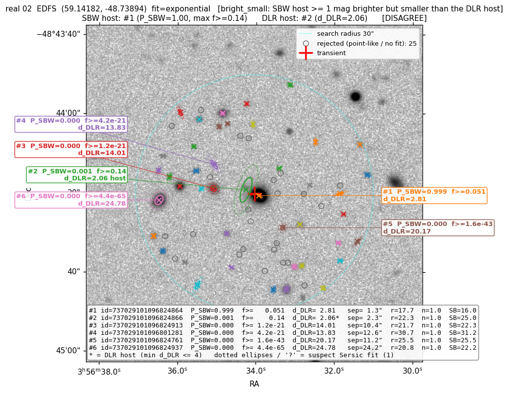
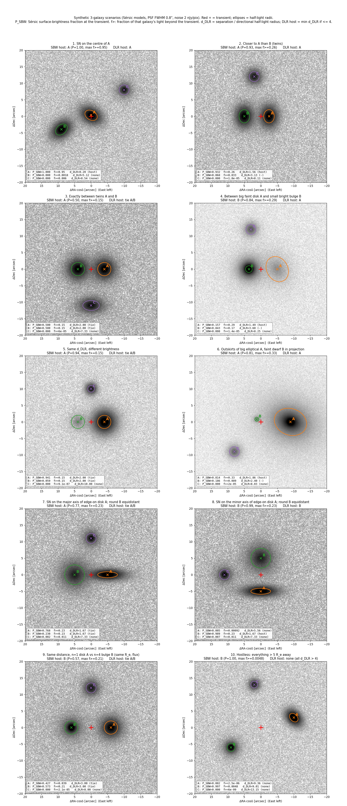

# sbw-host — SBW host-galaxy association for Rubin LSST transients

`sbw_host` associates transients with host galaxies using the Sérsic-type model
fits published in the Rubin LSST Object table. For a transient position it
evaluates every nearby galaxy's model surface brightness **at the transient** and
turns those into probabilities (SBW, *surface-brightness-weighted* association).
It also computes the classical directional-light-radius (DLR) metric for
comparison, flags unreliable fits, falls back across bands where coverage is
missing, and scales from one object to hundreds of thousands via grouped TAP
queries or an LSDB/HATS copy of the catalogue.

```python
from sbw_host import associate_host

res = associate_host(53.12934, -28.12088, band="r", radius_arcsec=30)
print(res["objectId", "p_sbw", "frac_light_beyond", "d_dlr", "sep_arcsec", "mag", "suspect"])
```

| objectId | p_sbw | frac_light_beyond | d_dlr | sep_arcsec | mag | suspect |
|---|---|---|---|---|---|---|
| 755369573523416412 | 1.000 | 0.20 | 1.81 | 0.97 | 19.89 | False |
| 755369573523416411 | 0.000 | 4e-05 | 5.65 | 10.99 | 19.25 | False |
| … | | | | | | |



*A real DP2 case where the two methods disagree: the transient (red +) sits 1.3″
from a bright compact galaxy, which SBW picks with P = 1.00, while DLR prefers a
large faint galaxy 2.3″ away because it is closer in units of its own radius.*

## Installation

```bash
pip install git+https://github.com/ConnorStoneAstro/sbw-host.git
# or, for development
git clone https://github.com/ConnorStoneAstro/sbw-host.git && cd sbw-host
pip install -e ".[dev]"            # add ,lsdb for the HATS backend
```

Python ≥ 3.10; depends on numpy, scipy, astropy, matplotlib, pyvo and requests.

### Rubin Science Platform token

Catalogue queries go through the RSP TAP service. Create a token at
<https://data.lsst.cloud> → *Account* → *Security tokens* with the scopes
`read:tap` (required) and `read:image` (for the figures' real cutouts), and
either

- save it in a file named `.rsp_image_tap_token` (or `.rsp_token`) in your working
  directory or home directory, or
- export it as `RSP_TOKEN`, or
- pass `token=` to the functions / `--token` to the command lines.

Without `read:image` everything runs; figures fall back to a render of the models.
The LSDB backend (below) needs no token.

## The method

For each extended object within the search radius, the Object table's MultiProFit
fit is evaluated at the transient position in the chosen band, giving a surface
brightness *I_i*. Then

    P_SBW(host = i) = I_i(SN) / Σ_j I_j(SN)

Every row also carries:

- **`frac_light_beyond`** — the fraction of that galaxy's own light outside the
  elliptical isophote through the transient (0.5 at the half-light radius). This
  is the *hostless* indicator: `p_sbw` always sums to one, so a transient in empty
  sky still gets P ≈ 1 for the least-far galaxy, but then every candidate has a
  tiny `frac_light_beyond`. Real hosts typically have 0.02–0.6.
- **`d_dlr`, `p_dlr`** — the directional light radius metric
  (d_DLR = separation / ellipse radius toward the transient, half-light ellipse;
  Sullivan et al. 2006, Gupta et al. 2016, Qu et al. 2024) and the hard DLR choice
  (smallest d_DLR if ≤ 4). `d_dlr` equals `m_rhalf`, the transient's elliptical
  radius in half-light units, so DLR is "nearest galaxy in units of its own size",
  blind to brightness and concentration.
- **`suspect`** — True for fits that are unreliable: centroid shifted > 1″ from the
  detection, model flux outside 0.5–2× the cModel flux, or bright-but-diffuse
  (mean surface brightness inside R_half fainter than 25.5 mag/arcsec² with
  total magnitude < 24). These are almost always faint deblended children that
  absorbed the halo of a bright star. They stay in the probabilities by default;
  `exclude_suspect=True` drops them.

### Which fit, and how it is evaluated

The Object table has two MultiProFit fits with identical machinery: a free-n
`sersic_*` fit and an n = 1 `exponential_*` fit (DP2 only). **The exponential fit
is the default** (`model="exponential"`): the free-n fit pins ~3 % of galaxies at
n ≈ 6, whose extended wings then dominate SBW from far away. `model="sersic"`
selects the other; on DP1, which lacks the exponential columns, the code falls
back to Sérsic with a warning.

Two facts about these fits matter for anyone using the columns, and are built in
(details and evidence in [`docs/sersic_reff_report/REPORT.md`](docs/sersic_reff_report/REPORT.md)):

1. The fitted model is a 4-Gaussian mixture (gauss2d_fit), not an analytic
   Sérsic; its wings are Gaussian. `sbw_host` evaluates exactly that mixture
   (`sersic_mix.py`, knot table from the pipeline source).
2. The catalogue `*_reff` is the mixture's scale parameter, not its half-light
   radius: the model's half-light radius is **1.386 × reff** for every n. Tables
   report both (`reff_*` and `rhalf_*`), and ellipses in figures are drawn at the
   true half-light radius. This was verified by subtracting PSF-convolved models
   from DP2 cutouts (χ²/pixel ≈ 3 for the mixture versus ≈ 40–80 for an analytic
   profile with R_e = reff).

Ellipse orientation uses the catalogue `(reff_x, reff_y, rho)` in the tract pixel
frame (+x West, +y North), verified against image moments; `sersic_theta` has the
opposite sign and is not used.

### Band fallback

The Object table has a row wherever *any* band was coadded, but per-band model
fluxes are NaN where that band is absent. If the requested band yields no
candidate, the other bands are tried in the order **r, i, g, z, u, y** until one
does; `band_used` (`meta['band_used']`) records which. Disable with
`band_fallback=False`.

## Single objects

```python
res = associate_host(ra, dec, band="r", radius_arcsec=30, max_hosts=5,
                     model="exponential", exclude_suspect=False)
res.meta        # counts of objects in radius, dropped point sources / bad fits, band_used, ...

# diagnostic figure: real deep_coadd cutout (with read:image) or a model render
res, fig = associate_host(ra, dec, plot=True)
associate_host(ra, dec, plot="host.png")
```

```bash
sbw-host 53.12934 -28.12088 --band r --radius 30 --plot host.png --csv host.ecsv
```

Columns (per candidate): `objectId, ra, dec, sep_arcsec, du_arcsec, dv_arcsec,
rhalf_major_arcsec, rhalf_minor_arcsec, reff_major_arcsec, reff_minor_arcsec,
phi_deg, sersic_index, flux_nJy, mag, refExtendedness, sb_eff,
centroid_shift_arcsec, flux_ratio_cmodel, suspect, from_blend, parent_nchild,
shape_flag, m_rhalf, m_reff, d_dlr, frac_light_beyond, log_intensity,
intensity_nJy_arcsec2, p_sbw, p_dlr`.



*Ten synthetic three-galaxy scenarios (`examples/synthetic_demo.py`) comparing SBW
and DLR: ties, size versus brightness, orientation, dwarfs in projection, hostless.*

## Many transients

```python
from sbw_host import associate_many

wide = associate_many(ra, dec, keys=dia_object_ids, n_hosts=3)
wide, long = associate_many(ra, dec, keys=dia_object_ids, n_hosts=3, return_long=True)
```

```bash
sbw-host-batch transients.csv --key-col diaObjectId --ra-col ra --dec-col dec \
    --n-hosts 3 --out hosts.ecsv --long hosts_long.ecsv
```

`keys` is any array of unique identifiers (ints, strings, …) carried through as
`transient_key`. The wide table has one row per transient:

`transient_key, transient_ra, transient_dec, n_in_radius, n_candidates,
n_dropped_bad_fit, n_dropped_pointlike, band_used, dlr_host_objectId,
dlr_host_ra, dlr_host_dec, dlr_host_d_dlr` (the smallest-d_DLR candidate
regardless of the 4 cut, so it can be applied downstream), then for i = 1..N in
decreasing `p_sbw`: `host_i_objectId, host_i_ra, host_i_dec, host_i_p_sbw,
host_i_frac_light_beyond, host_i_d_dlr, host_i_sep_arcsec, host_i_mag,
host_i_suspect` (objectId 0 / NaN when fewer than N candidates). All candidates
within the radius enter the probabilities regardless of N. The optional long
table is the stacked per-candidate output with a `transient_key` column.

**TAP backend (default).** A single cone query costs ~3.6 s, so transients are
grouped into 0.3° sky cells and each occupied cell gets one asynchronous regional
query (a few run concurrently); candidates are then selected locally with a
KD-tree and the same per-object computation runs. About 25 ms per transient for
clustered lists; isolated transients fall back to cone searches.

**LSDB backend.** With a HATS copy of the Object table (e.g. NERSC:
`/global/cfs/cdirs/lsst/shared/rubin/DP2/HATS/object_collection`):

```bash
pip install "sbw-host[lsdb]"
sbw-host-batch transients.csv --key-col diaObjectId --n-hosts 3 --lsdb \
    [--lsdb-path /path/to/object_collection] [--lsdb-workers 4] [--lsdb-chunk 2000] --out hosts.ecsv
```

or `associate_many(..., backend="lsdb")`. The transients are crossmatched against
the catalogue in chunks (galaxies on the left, transients on the right with a
margin of radius + 15″, because lsdb checks the right side's margin against the
radius), each chunk's associations are computed and flattened, and the candidate
rows are freed before the next chunk, so memory stays bounded. Each Object
partition touched is read into memory while processed, hence the default of 4
Dask threads; raise it on a compute node, or create your own `dask.distributed`
Client (detected automatically) with explicit memory limits. HATS collections may
expose only a default column subset; the code reads `all_columns` and opens the
catalogue with exactly the columns it needs (`sbw-host-batch --lsdb-list-columns`
shows them). Both backends give identical results for the same catalogue
contents.

### Reviewing disagreements

```bash
sbw-host-review hosts.csv --token .rsp_image_tap_token --n 20 --out review/
```

picks random rows of a batch table where the DLR candidate differs from the SBW
top host, downloads a cutout for each and marks the transient, the SBW-ranked
hosts and the DLR host. `--include-dlr-none` also samples rows where DLR finds no
host; `--full` re-runs the association and draws the complete diagnostic figure.

## Examples and tests

`examples/` contains the scripts used during development: real-data cases
(`run_examples.py`), the synthetic scenarios, a search for SBW/DLR disagreements
on real fields (`disagreement_search.py`, `real_demo.py`), the model-residual
check against cutouts (`check_sersic_model.py`) and the figures of the pipeline
report (`make_report_figures.py`, which additionally needs AstroPhot).

```bash
pytest                   # offline unit tests (Sérsic math, mixture, probabilities, batch assembly, ...)
pytest --run-network     # also the live tests against DP2 (needs a token)
```

## Caveats

- The Object table holds deblended children and isolated objects only; a large
  galaxy shredded by the deblender appears as several candidates sharing its
  light.
- `p_sbw` is relative to the retrieved candidates; use `frac_light_beyond` (or
  `dlr_host_d_dlr`) to judge hostlessness.
- Qserv rejects `CASE WHEN` and `TOP n … ORDER BY` in ADQL; a column named `key`
  breaks TAP uploads.

## Citing

If you use this code, please cite the repository. The DLR definition follows
Qu et al. (2024, ApJ, "The Dark Energy Survey Supernova Program: Cosmological
Biases from Host Galaxy Mismatch of Type Ia Supernovae").
