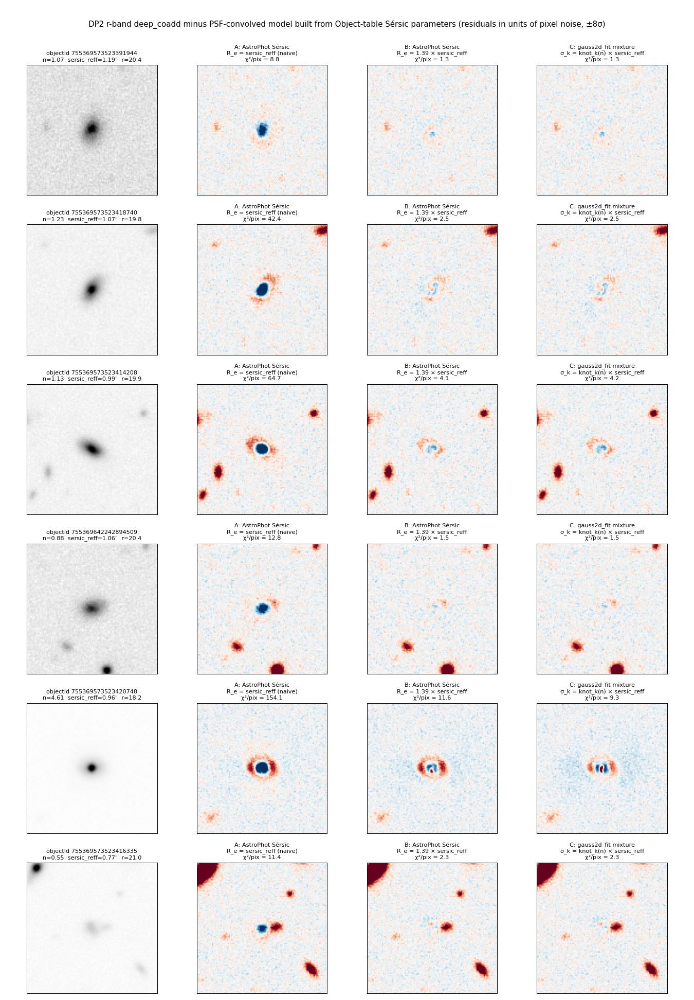
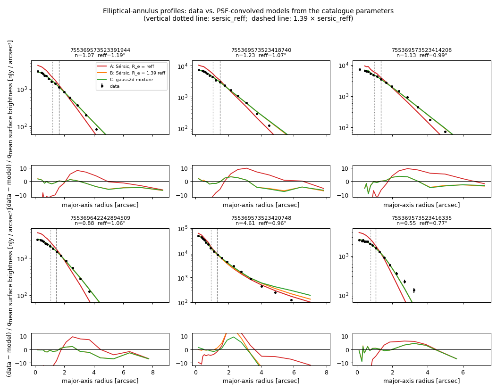
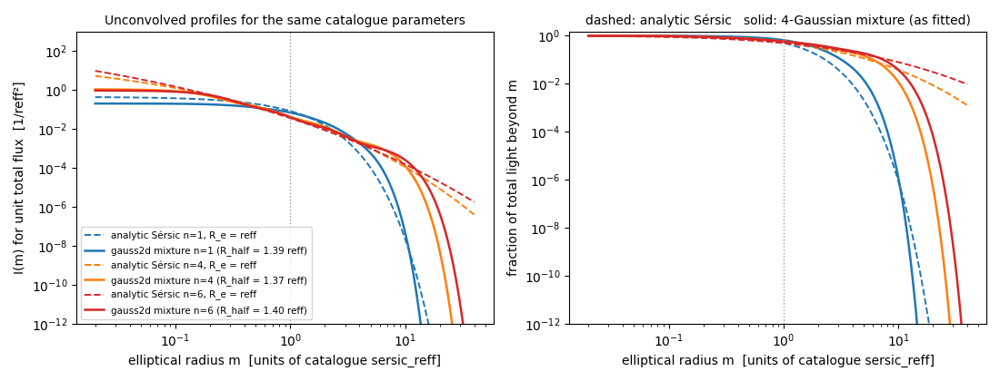

# DP2 Object-table `sersic_reff` is not the half-light radius of the fitted model

**Summary.** The MultiProFit Sérsic fit published in the DP2 `Object` table
(`sersic_reff_x/y`, `sersic_reff_major/minor`, `sersic_index`, `{band}_sersicFlux`)
is a 4-Gaussian mixture whose component sigmas are `knot_sigma_k(n) × sersic_reff`.
With the knot table as shipped, the mixture's half-light radius is
**(2 ln 2) × sersic_reff = 1.386 × sersic_reff**, to within 1% for every Sérsic
index from 0.5 to 8. The schema describes these columns as "Effective radius", and a
user who builds a Sérsic profile with R_e = `sersic_reff` gets a model that is ~40%
too small. We confirmed this directly on DP2 r-band `deep_coadd` cutouts by
subtracting PSF-convolved models from isolated galaxies (Figures 1 and 2). A
secondary consequence is that the fitted profile has Gaussian wings, so analytic
Sérsic extrapolations of the catalogue model overstate the light at large radii by
many orders of magnitude (Figure 3).

Author: Connor Stone (connor.stone@utoronto.ca). Analysis code and figures:
`host_association/report/` (`make_report_figures.py`); the mixture reproduction is
in `host_association/hostassoc/sersic_mix.py`. Code references below are to the
`main` branches as of 2026-10-06 (commits: gauss2d_fit `4e61e667d684`, gauss2d
`b90b002fd1c7`, multiprofit `1988d86b4c72`, meas_extensions_multiprofit
`91873aba28fa`, sdm_schemas `016e612ca712`).

## 1. Evidence from the images

Six isolated, bright DP2 galaxies (ECDFS, tract 5063, r band, n from 0.55 to 4.6)
were modelled three ways from their catalogue parameters alone (no refitting) and
convolved with the two-Gaussian PSF model stored in the Object table
(`r_psfModel_TwoGaussian_*`), i.e. the PSF MultiProFit itself used:

| model | definition |
|---|---|
| **A. naive** | AstroPhot `sersic galaxy model`, R_e = `sersic_reff_major`, q = `reff_minor/reff_major`, n = `sersic_index`, total flux = `r_sersicFlux` |
| **B. rescaled** | same as A with R_e = 1.386 × `sersic_reff_major` |
| **C. as fitted** | the gauss2d_fit 4-Gaussian mixture: σ_k = knot_k(n) × `sersic_reff`, weights w_k(n), from `sersicmix.cc` |

χ² per pixel inside 3 `sersic_reff` (pixel noise from the image MAD):

| objectId | n | sersic_reff (″) | r mag | A naive | B ×1.386 | C mixture |
|---|---|---|---|---|---|---|
| 755369573523391944 | 1.07 | 1.19 | 20.4 | 8.8 | 1.3 | 1.3 |
| 755369573523418740 | 1.23 | 1.07 | 19.8 | 42.4 | 2.5 | 2.5 |
| 755369573523414208 | 1.13 | 0.99 | 19.9 | 64.7 | 4.1 | 4.2 |
| 755369642242894509 | 0.88 | 1.06 | 20.4 | 12.8 | 1.5 | 1.5 |
| 755369573523420748 | 4.61 | 0.96 | 18.2 | 154.1 | 11.6 | 9.3 |
| 755369573523416335 | 0.55 | 0.77 | 21.0 | 11.4 | 2.3 | 2.3 |
| **mean** | | | | **49.0** | **3.9** | **3.5** |



*Figure 1. Data and (data − model)/σ for the three models. The naive model (A) leaves a
strongly negative core and positive ring in every galaxy: it is too concentrated. B
and C are nearly identical and flat, except for the n = 4.6 galaxy, where the
mixture's truncated wings (C) fit slightly better than the analytic profile (B).*



*Figure 2. Elliptical-annulus surface-brightness profiles in the catalogue ellipse
frame. The data (points) follow B and C; A (red) is too bright inside ~1″ and too
faint outside. The dotted and dashed lines mark `sersic_reff` and 1.386 × `sersic_reff`.*



*Figure 3. Unconvolved profile (left) and fraction of light beyond radius m (right)
for the same catalogue parameters, analytic Sérsic (dashed) versus the fitted
mixture (solid). Beyond ~5 reff the two differ by orders of magnitude; for n = 6 at
m = 22.7 the analytic profile puts 2.6% of the light outside, the fitted model 6 × 10⁻⁶.*

## 2. Where this comes from in the pipeline code

1. **The Sérsic component is a Gaussian mixture, and each component's sigma is
   `size ratio × reff`.**
   [`gauss2d_fit/src/sersicmixcomponent.cc` L44–L47](https://github.com/lsst/gauss2d_fit/blob/4e61e667d684/src/sersicmixcomponent.cc#L44-L47):
   ```cpp
   double get_sizeratio() const { return _sersicindex->get_sizeratio(_index); }
   double get_sigma_x() const override { return get_sizeratio() * _size_x->get_value(); }
   double get_sigma_y() const override { return get_sizeratio() * _size_y->get_value(); }
   ```
   `_size_x` / `_size_y` are the `ReffXParameterD` / `ReffYParameterD` whose values
   become `sersic_reff_x/y`. Each sub-Gaussian is evaluated with the ordinary
   normalisation `integral / (2π σ_x σ_y √(1−ρ²))`
   ([`gauss2d/src/gaussian.cc` L54](https://github.com/lsst/gauss2d/blob/b90b002fd1c7/src/gaussian.cc#L54)
   with `EllipseData::get_area()` in `ellipse.cc`), so `sigma` here is a true Gaussian σ.

2. **The size ratios come from the knot table**
   [`gauss2d_fit/src/sersicmix.cc` L68–L75](https://github.com/lsst/gauss2d_fit/blob/4e61e667d684/src/sersicmix.cc#L68-L75)
   (`get_sersic_mix_knots_copy`, order 4; order 8 starts at L488). The first knot is
   ```cpp
   SersicMixValues(0.5, {IntegralSize(1.0, 1.1774100225154747), ...
   ```
   i.e. for n = 0.5 the model is a single Gaussian with σ = 1.1774 × reff. A Gaussian's
   half-light radius is HWHM = 1.1774 σ, so this component's half-light radius is
   1.1774² reff = (2 ln 2) reff = 1.386 reff. For a Gaussian with half-light radius
   reff the entry should be 1/1.1774 = 0.849. The same factor appears at every n: solving
   Σ w_k exp(−m²/2σ_k²) = ½ for the shipped knots gives R_half/reff = 1.386 (n ≤ 2),
   1.374 (n = 4), 1.401 (n = 6), 1.387 (n = 8) for order 4, and 1.365–1.386 for order 8.
   The constant `M_HWHM_SIGMA = 1.1774…` is defined in
   [`gauss2d/include/lsst/gauss2d/ellipse.h` L38–L39](https://github.com/lsst/gauss2d/blob/b90b002fd1c7/include/lsst/gauss2d/ellipse.h#L38-L39);
   the knot sigmas look like R_e-based values multiplied by `M_HWHM_SIGMA` where they
   should have been divided by it (or equivalently multiplied by `M_HWHM_SIGMA²`
   instead of nothing). We could not locate the script that generated the knots to
   confirm which.

3. **The pipeline uses order 4, free n, and the mixture path.**
   [`multiprofit/componentconfig.py` L477](https://github.com/lsst/multiprofit/blob/1988d86b4c72/python/lsst/multiprofit/componentconfig.py#L477)
   sets `order = ChoiceField(default=4)`; `SERSICMIX_ORDER_DEFAULT = 4` in
   [`gauss2d_fit/include/lsst/gauss2d/fit/sersicmix.h` L14](https://github.com/lsst/gauss2d_fit/blob/4e61e667d684/include/lsst/gauss2d/fit/sersicmix.h#L14).
   `SersicComponentConfig.make_component`
   ([L512–L548](https://github.com/lsst/multiprofit/blob/1988d86b4c72/python/lsst/multiprofit/componentconfig.py#L512-L548))
   builds a `g2f.SersicParametricEllipse(ReffXParameterD, ReffYParameterD, Rho)` plus a
   `SersicMixComponent` unless n is fixed at 0.5, in which case a plain
   `GaussianComponent` with a `GaussianParametricEllipse` is used instead (docstring
   at [L460–L463](https://github.com/lsst/multiprofit/blob/1988d86b4c72/python/lsst/multiprofit/componentconfig.py#L460-L463)).
   Worth checking that the two paths agree on what "size" means for n = 0.5: in the
   Gaussian path the size parameter is σ; in the mixture path it is σ/1.1774.
   The DP2 task (`MultiProFitCoaddSersicFitTask`,
   [`meas_extensions_multiprofit/pipetasks_fit.py` L371–L461](https://github.com/lsst/meas_extensions_multiprofit/blob/91873aba28fa/python/lsst/meas/extensions/multiprofit/pipetasks_fit.py#L371-L461))
   does not override `order`. The fit is initialised with the moments σ as the
   initial `reff`
   ([`fit_coadd_multiband.py` L629–L636](https://github.com/lsst/meas_extensions_multiprofit/blob/91873aba28fa/python/lsst/meas/extensions/multiprofit/fit_coadd_multiband.py#L629-L636)),
   and the parameter value is written out unchanged as the `reff` column
   (`size_column="reff"`, L740 and L821 of the same file).

4. **The schema calls it an effective radius.**
   [`sdm_schemas/.../drp_base.yaml` L2594–L2610](https://github.com/lsst/sdm_schemas/blob/016e612ca712/python/lsst/sdm/schemas/drp_base.yaml#L2594-L2610):
   `sersic_reff_major`: "Effective radius (major axis) from the multiband Sersic model
   fit, prior to convolution with the PSF model…", and likewise `sersic_reff_minor`,
   `sersic_reff_x`, `sersic_reff_y`. DP1 carries the same columns and the same code
   path, so DP1 is affected too.

## 3. Suggested follow-up

* Decide whether `sersic_reff` is meant to be the half-light radius. If yes, either
  divide every knot sigma in `sersicmix.cc` by 2 ln 2 (which changes the fitted
  parameter values but not the models), or multiply the `reff` parameters by 2 ln 2
  when writing the catalogue. If no, change the schema description and document the
  factor.
* Add a unit test in gauss2d_fit asserting that a `SersicMixComponent` with
  `reff = 1` encloses half its light inside m = 1 (the existing
  `tests/test_sersicmixcomponent.cc` only checks ordering and totals).
* Check the fixed-n = 0.5 `GaussianComponent` path for consistency with the mixture
  path (point 3 above), and any downstream code that interprets `sersic_reff` as a
  half-light radius (sizes, size–magnitude priors such as
  `MagnitudeDependentSizePriorConfig`, shear calibration).
* Consider documenting, alongside the columns, that the model is a Gaussian mixture
  with Gaussian wings, so users do not extrapolate it with an analytic Sérsic.

## 4. Reproducing

```bash
cd host_association
# needs .rsp_token (scope read:tap) and .rsp_image_token (scope read:image)
PYTHONPATH=. python report/make_report_figures.py
```
`hostassoc/sersic_mix.py` holds the knot table (parsed from `sersicmix.cc`) and the
mixture evaluation; `half_light_factor(n)` returns R_half/reff. The AstroPhot models
use its `sersic galaxy model` with I_e set from the total flux and the PSF supplied
as a `PSFImage`; the orientation of the AstroPhot and mixture renders was checked to
agree to < 1° by image moments.
